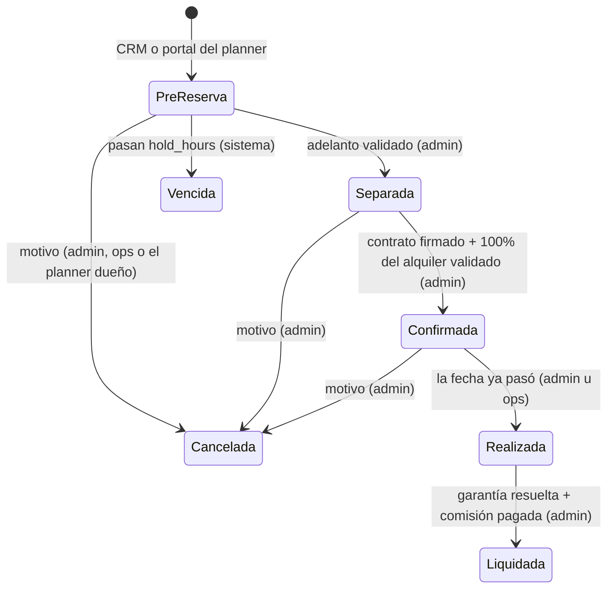

# Modelo operativo · Oasis Pachacámac

- **Fecha:** 18/10/2026
- **Estado:** Borrador para validación de André y Carlos
- **Relacionados:** [Roles y RACI](261018%20Roles%20y%20RACI.md) · [Políticas](261018%20Politicas.md) · [Manual por rol](261018%20Manual%20por%20rol.md) · [Programa de planners](261018%20Programa%20de%20planners.md) · [Plan de pauta 90 días](261018%20Plan%20de%20pauta%2090%20dias.md) · [Equipo de agentes](agentes.md) · [Supuestos](supuestos.md) · [Especificación (OASIS.md)](../OASIS.md)

> Todas las cifras de este documento salen de parámetros en `settings` (se editan en `/admin/configuracion`, solo el admin) o son supuestos registrados en [supuestos.md](supuestos.md). Lo marcado [COMPLETAR] o [VALIDAR] no es dato real todavía.

## 1. En una frase

Operamos un local propio de SAWA (S13) para tres segmentos, con **una sola reserva por día** (`booking_mode = one_per_day`), venta por planners (5%) y venta directa con pauta, y un sistema que responde, cotiza, avisa y mide. **Criterio de éxito: ocupación** (OASIS.md §4), controlada con el ingreso neto por día disponible para no crecer a punta de descuentos.

Promesa al cliente final (manual de marca): **belleza del lugar + facilidad operativa + libertad para personalizar**.
Mensaje para planners: _"Nosotros hacemos que el espacio funcione; tú haces que el evento sea único."_

## 2. Propuesta de valor por segmento

| Segmento                                                       | Cliente típico                             | Qué necesita                                                    | Qué le ofrecemos                                                                                                       | Aforo de referencia (`capacity`)     | Franja (`slot_hours`)                        | Canal principal                                 | Landing        |
| -------------------------------------------------------------- | ------------------------------------------ | --------------------------------------------------------------- | ---------------------------------------------------------------------------------------------------------------------- | ------------------------------------ | -------------------------------------------- | ----------------------------------------------- | -------------- |
| **Bodas y sociales** (matrimonios, quinceañeros, aniversarios) | Pareja o familia, casi siempre con planner | Un lugar bonito, exclusivo, que no le imponga proveedores       | Exclusividad (1 evento por día), libertad de catering, música y decoración, equipo que coordina la operación del local | `cocktail` 150 / `banquet` 100 (S02) | Evento noche 19:00–03:00 (pernocte opcional) | Planners + Google Search + directorios de bodas | `/bodas`       |
| **Corporativo** (full day, team building, offsites, cierres)   | Área de RR. HH., marketing o gerencia      | Logística resuelta, factura con IGV, fechas entre semana        | Tarifas L–J, factura electrónica de SAWA, coordinación con sus proveedores o aliados recomendados                      | `banquet` 100 (S02)                  | Full day 09:00–18:00                         | Venta directa (Google Search) y referidos       | `/corporativo` |
| **Full day familiar** (cumpleaños, reuniones, grupos)          | Familia o grupo de amigos                  | Piscina y parrilla sin compartir con otros grupos, precio claro | Casa completa y exclusiva por el día, pernocte opcional                                                                | `full_day` 60 (S02)                  | Full day 09:00–18:00                         | Meta/IG + WhatsApp                              | `/full-day`    |

Notas:

- Precios: matriz de `rate_cards` (tipo de evento × tipo de día × temporada × aforo). Hoy son **placeholders** del benchmark (S19, S24) y falta definir si se publican con o sin IGV.
- Temporada alta: `high_season_months` = dic–mar.
- Espacios reales (dormitorios, baños, estacionamiento): [COMPLETAR] (S12).

## 3. Journey del cliente

| #   | Etapa                 | Qué vive el cliente                                              | Qué hacemos                                                      | Etapa CRM / estado de reserva               | Pantalla o automatización                                                                              |
| --- | --------------------- | ---------------------------------------------------------------- | ---------------------------------------------------------------- | ------------------------------------------- | ------------------------------------------------------------------------------------------------------ |
| 1   | Descubrimiento        | Ve un anuncio, un post, una reseña o lo recomienda su planner    | Pauta por segmento, Google Business Profile, contenido, planners | —                                           | Web pública (`/`, landings). Agentes Growth y Contenido (propuestas)                                   |
| 2   | Consulta              | Revisa disponibilidad, usa el cotizador, abre el chat o WhatsApp | Respondemos al instante (chat) y en ≤ 15 min hábiles (humano)    | Lead **Nuevo** (con UTM y gclid/fbclid)     | Recepcionista del chat, formulario con antispam, botón de WhatsApp. Alerta de SLA cada 15 min          |
| 3   | Calificación y visita | Cuenta fecha, aforo, tipo de evento, presupuesto; agenda visita  | Llamada o WhatsApp, visita al local                              | **Contactado** → **Visita agendada**        | `/admin/crm` y ficha `/admin/crm/[id]` (actividades con fecha)                                         |
| 4   | Cotización            | Recibe una cotización en PDF, con y sin IGV                      | Cotización versionada; descuento solo dentro del tope            | **Cotizado**                                | `/admin/reservas/[id]` → Documentos (cotización v1, v2…)                                               |
| 5   | Pre-reserva           | Su fecha queda apartada 72 h                                     | Pedimos el adelanto; el Closer vigila las que vencen             | Reserva **Pre-reserva** (`hold_hours` = 72) | Desde el CRM ("crear pre-reserva") o el planner en `/planners/portal`. Vence sola (pg_cron cada 5 min) |
| 6   | Separada              | Paga el adelanto y envía el voucher                              | Registramos el pago; **el admin lo valida**                      | **Separada**                                | `/admin/reservas/[id]` → Pagos                                                                         |
| 7   | Confirmada            | Firma el contrato y paga el saldo antes del D-15                 | Recordatorios de saldo; registro de contrato firmado             | **Confirmada**                              | Aviso diario 08:00 (3 días antes, el día y vencido). Contrato PDF en Documentos                        |
| 8   | Preparación           | Coordina proveedores y horarios                                  | Checklist D-7 y D-1, avisos al cliente (o a su planner)          | Confirmada                                  | `/admin/reservas/[id]/operacion` → Checklists. Avisos D-7 y D-1                                        |
| 9   | Evento                | Recibe el local, celebra, lo devuelve                            | Acta de entrega y de recepción con fotos; incidencias            | **Realizada**                               | `/admin/reservas/[id]/operacion` → Acta con fotos, Incidencias y daños                                 |
| 10  | Liquidación           | Recupera su garantía (o el saldo de ella)                        | Garantía devuelta o aplicada; comisión del planner pagada        | **Liquidada**                               | `/admin/reservas/[id]` → Liquidación (solo admin)                                                      |
| 11  | NPS y recomendación   | Califica de 0 a 10 y comenta                                     | Enviamos la encuesta; pedimos reseña si es promotor              | —                                           | Enlace `/encuesta/[token]` desde Operación (hoy se envía a mano). Resultado en el dashboard            |

Si el cliente no avanza: el lead pasa a **Perdido** con motivo obligatorio (alimenta "Top motivos de pérdida" en el dashboard). Una pre-reserva no pagada pasa a **Vencida** y la fecha vuelve a Libre sola.

## 4. Flujo comercial de punta a punta con el sistema

Bloqueada no es un estado de reserva: es un **bloqueo de mantenimiento** en `/admin/calendario` (S14: no hay uso propio de Carlos).

| Paso | Qué pasa                          | Quién                         | Pantalla                                                       | Automatización o regla del sistema                                                                                                                               |
| ---- | --------------------------------- | ----------------------------- | -------------------------------------------------------------- | ---------------------------------------------------------------------------------------------------------------------------------------------------------------- |
| 1    | Entra el lead                     | Cliente / planner             | Web, chat, WhatsApp, `/planners/portal/clientes`               | Se guarda UTM y gclid/fbclid. Match por teléfono, correo o RUC contra clientes de planners (`planner_protection_days` = 90): alerta de duplicado en el CRM       |
| 2    | Primera respuesta                 | Recepcionista (24/7) y staff  | Chat web · `/admin/crm`                                        | SLA `first_response_sla_minutes` = 15 en `business_hours`. Alerta "Leads sin respuesta" cada 15 min                                                              |
| 3    | Derivación a humano               | Recepcionista → staff         | `/admin/agentes` (derivaciones) · correo                       | Aviso "El Recepcionista derivó una conversación" cuando pide precio especial, descuento o excepción                                                              |
| 4    | Calificación, visita, actividades | Staff                         | `/admin/crm/[id]`                                              | Etapas manuales: Nuevo, Contactado, Visita agendada, Cotizado, Perdido                                                                                           |
| 5    | Cotización y pre-reserva          | Staff (o planner con su hold) | `/admin/crm/[id]` → crear pre-reserva · `/admin/reservas/[id]` | El motor de precios calcula con y sin IGV. Descuento > `discount_cap_pct` (10%) solo si lo aprueba el admin. La BD impide dos reservas activas en la misma fecha |
| 6    | Pago del adelanto                 | Cliente → staff registra      | `/admin/reservas/[id]` → Pagos (con voucher)                   | Pago queda "pendiente" hasta que el **admin** lo valida. Adelanto = `deposit_pct` (50%) del total con IGV                                                        |
| 7    | Separación                        | Admin                         | `/admin/reservas/[id]` → Estado                                | La transición exige adelanto validado. Queda en `audit_log`                                                                                                      |
| 8    | Contrato y saldo                  | Staff + cliente; admin valida | Documentos (contrato PDF), Pagos                               | Saldo vence `balance_due_days` (15) antes. Avisos `balance_notice_days` (3) antes, el día y vencido                                                              |
| 9    | Confirmación                      | Admin                         | Estado                                                         | Exige contrato registrado y 100% del alquiler validado                                                                                                           |
| 10   | Operación previa                  | Ops en sitio                  | `/admin/reservas/[id]/operacion`                               | Avisos D-7 y D-1 al cliente (al planner si la reserva es suya, S29) y resumen diario de operación al staff                                                       |
| 11   | Entrega, evento y recepción       | Ops en sitio                  | Operación → Acta con fotos, Incidencias y daños                | —                                                                                                                                                                |
| 12   | Realizada                         | Ops o admin                   | Estado                                                         | Si está cobrada al 100% y hay planner, la comisión (5% del alquiler sin IGV) se devenga sola                                                                     |
| 13   | Costos del evento                 | Ops                           | Operación → Costos directos                                    | Estándar en `standard_event_costs` vs. real; alimenta margen por evento                                                                                          |
| 14   | Garantía y comisión               | Admin                         | `/admin/reservas/[id]` → Liquidación · `/admin/finanzas`       | Comisión se paga `commission_payment_days` (7) después. Liquidar exige garantía resuelta y comisión pagada                                                       |
| 15   | NPS                               | Ops                           | Operación → Encuesta NPS                                       | Enlace único por reserva; el resultado entra al dashboard                                                                                                        |
| 16   | Medición                          | Socios                        | `/admin/dashboard` · resumen semanal por correo (lunes)        | Ocupación V-S-D vs. L-J, comprometida a 90 días, ingreso neto por día disponible, CAC vs. 5% del ticket                                                          |

## 5. SLA

| Compromiso                          | Meta                                                         | Parámetro / fuente                                                | Cómo se controla                                                                   |
| ----------------------------------- | ------------------------------------------------------------ | ----------------------------------------------------------------- | ---------------------------------------------------------------------------------- |
| Primera respuesta a un lead         | ≤ 15 min **hábiles**                                         | `first_response_sla_minutes` = 15                                 | Alerta automática cada 15 min (L–S); "tiempo de primera respuesta" en el dashboard |
| Horario comercial                   | L–S 09:00–19:00                                              | `business_hours` (S11, por confirmar)                             | Fuera de horario responde el Recepcionista; el humano responde al abrir            |
| Respuesta del chat                  | Inmediata, 24/7                                              | Recepcionista (tope de gasto `agent_monthly_budget_usd` = USD 30) | `/admin/agentes` → Conversaciones y gasto del mes                                  |
| Validar un voucher                  | [VALIDAR propuesta: mismo día hábil]                         | —                                                                 | Pagos pendientes en la reserva                                                     |
| Seguimiento de cotización           | [VALIDAR propuesta: a las 48 h y antes de que venza el hold] | `hold_hours` = 72                                                 | Agente Closer (diario 09:00) y resumen diario de holds por vencer en 24 h          |
| Devolución de la garantía           | [COMPLETAR plazo]                                            | —                                                                 | Liquidación de la reserva                                                          |
| Pago de comisión al planner         | 7 días después de Realizada y cobrada al 100%                | `commission_payment_days` = 7                                     | Comisiones por pagar en dashboard y `/admin/finanzas`                              |
| Respuesta al Libro de Reclamaciones | ≤ 15 días hábiles (por validar con abogado)                  | Ley 29571 / D.S. 011-2011-PCM (ver checklist legal)               | [COMPLETAR: hoy no hay pantalla ni alerta en el back-office]                       |

Nota técnica: la alerta de SLA corre según `vercel.json` (cada 15 min, L–S, 09:00–18:45 de Lima). Si se cambia `business_hours`, hay que ajustar también ese horario. En Vercel Hobby solo correría una vez al día (S30).

## 6. Automatizaciones

Corren como actor "sistema" y **solo avisan**: no cambian tarifas, no validan pagos ni pagan comisiones.

| Proceso                | Cuándo (hora Lima)                                 | Qué hace                                                          | Para quién                      | Dónde se ve               |
| ---------------------- | -------------------------------------------------- | ----------------------------------------------------------------- | ------------------------------- | ------------------------- |
| Vencimiento de holds   | Cada 5 min (pg_cron) y antes de cada reserva nueva | Pasa a Vencida toda pre-reserva sin pagar después de `hold_hours` | —                               | Calendario, CRM           |
| Recordatorios de saldo | Diario 08:00                                       | 3 días antes del vencimiento, el día y una vez vencido            | Cliente directo o planner (S29) | `/admin/avisos`           |
| Avisos D-7 y D-1       | Diario 08:00                                       | Recordatorio del evento                                           | Cliente directo o planner       | `/admin/avisos`           |
| Resumen de operación   | Diario 08:00                                       | Eventos próximos y holds que vencen en 24 h                       | Staff                           | Correo                    |
| Leads sin respuesta    | Cada 15 min (L–S)                                  | Alerta de leads fuera del SLA                                     | Staff                           | Correo · `/admin/crm`     |
| Derivación del chat    | Al momento                                         | El Recepcionista pasa la conversación a un humano                 | Staff                           | Correo · `/admin/agentes` |
| Resumen semanal        | Lunes 08:05                                        | Ocupación a 90 días, pipeline, leads, CAC, alertas                | Socios                          | Correo                    |
| Feed iCal              | Continuo                                           | Calendario maestro en Google Calendar                             | Socios                          | `/admin/avisos`           |

WhatsApp: hasta tener la Cloud API, los avisos por WhatsApp quedan en cola con enlace `wa.me` prellenado; el staff los envía y los marca como enviados en `/admin/avisos` (S31). Los correos salen por Resend.

## 7. Agentes de IA: rol y límites

Detalle en [agentes.md](agentes.md) y [agents/README.md](../agents/README.md).

| Agente                 | Tipo                   | Cadencia              | Aporta a la ocupación                                                                                | Lo que **no** hace                                                                     |
| ---------------------- | ---------------------- | --------------------- | ---------------------------------------------------------------------------------------------------- | -------------------------------------------------------------------------------------- |
| Recepcionista          | Tiempo real (chat web) | 24/7                  | Responde en segundos, califica, consulta disponibilidad, da el rango del cotizador, registra el lead | No negocia precios, no da descuentos, no crea pre-reservas (S35), no confirma reservas |
| Operaciones            | Automatización         | Diario 08:00 · 15 min | Recordatorios de saldo, D-7/D-1, SLA, resumen semanal                                                | No aplica cargos a la garantía                                                         |
| Closer                 | Por cadencia           | Diario 09:00          | Detecta cotizaciones sin respuesta y holds por vencer; redacta seguimientos                          | No ofrece condiciones especiales                                                       |
| Revenue manager        | Por cadencia           | Lunes 09:30           | Propone promos dentro del tope para fechas libres a 15–60 días                                       | No cambia tarifas ni parámetros                                                        |
| Growth / pauta         | Por cadencia           | Lunes 10:00           | CAC vs. 5% del ticket, propone cortes y redistribución, copys                                        | No mueve presupuesto                                                                   |
| Planners               | Por cadencia           | Miércoles 10:00       | Prospecta planners, redacta outreach y onboarding                                                    | No da de alta planners (solo el admin invita)                                          |
| Controller             | Por cadencia           | Viernes 09:00         | Sugiere el match de vouchers, comisiones por pagar, costos vs. estándar                              | No valida pagos ni paga comisiones                                                     |
| Contenido y reputación | Por cadencia           | Jueves 10:00          | Posts, respuestas a reseñas, SEO local                                                               | No publica sin aprobación                                                              |

Guardarraíles (OASIS.md §15.3, CLAUDE.md regla 6):

1. Ningún agente valida pagos, aprueba descuentos sobre el tope, cambia tarifas o parámetros, firma contratos ni marca comisiones como pagadas.
2. Los agentes por cadencia **solo leen y proponen** (máximo 3 propuestas por corrida). El admin aprueba o rechaza en `/admin/agentes` y luego aplica el cambio él mismo.
3. Todo queda en `audit_log` con `actor_type = agent`.
4. Nada físico: abrir el portón, entregar el local o revisar daños lo hace la persona en sitio.
5. Los agentes por cadencia se programan cerca de la reapertura, desde el 01/12/2026 (S36).

## 8. Regla de canal

- Planner: comisión `planner_commission_rate` = 5% del alquiler sin IGV.
- Directo: conviene mientras el **CAC por evento cerrado sea menor al 5% del ticket**. El dashboard lo compara cada mes y alerta cuando la pauta cuesta más que la comisión.
- Pauta mensual de referencia: `monthly_ad_budget` = S/ 1,500.00 (S09). Metas de ocupación en `occupancy_targets` (S10).

## 9. Vacíos por resolver

1. NPS: el enlace se copia a mano desde Operación; falta envío automático post-evento.
2. Libro de Reclamaciones: los reclamos se guardan, pero no hay pantalla ni alerta en el back-office para responderlos en plazo.
3. Reprogramación: está en la política y en el contrato, pero el sistema no tiene un flujo propio (hoy sería cancelar y crear otra reserva).
4. El planner no puede subir vouchers desde su portal: los envía al staff [COMPLETAR canal].
5. Persona en sitio, cuentas de pago, WhatsApp comercial y dominio: [COMPLETAR] (S18, S20, S33).
